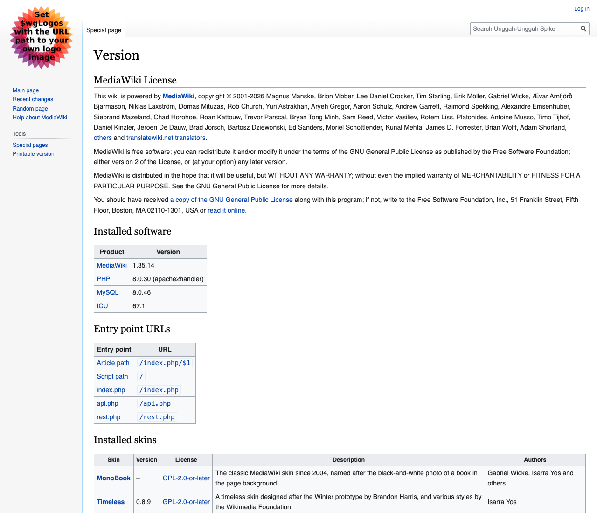
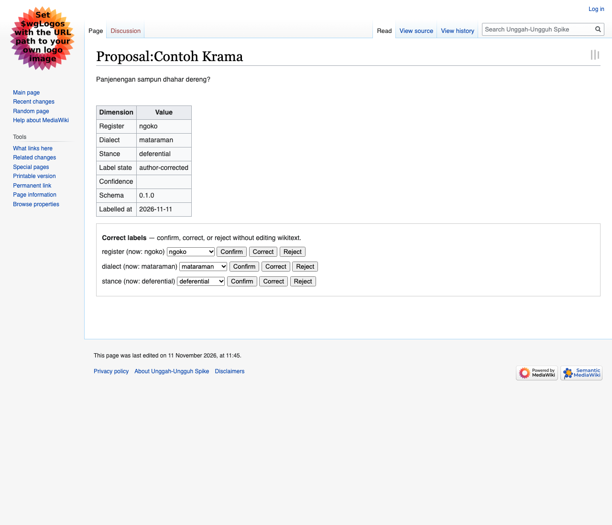
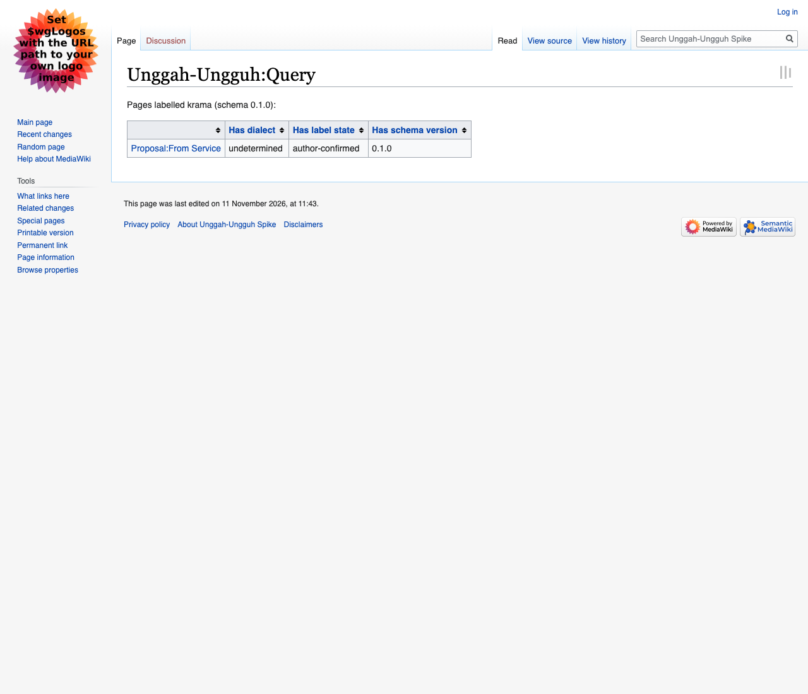

# Unggah-Ungguh spike

Local demonstration that a sidecar can label Javanese register, dialect, and
stance on a **MediaWiki 1.35.14 + Semantic MediaWiki 3.2.3** wiki, and that a
reader can correct those labels without editing wikitext.

This is a spike, not the fellowship project. Schema version **0.1.0**.

## 60-second quickstart

```bash
make up
make seed
make test
make eval
```

Then open:

- wiki: http://localhost:8080/index.php/Proposal:Contoh_Krama
- ask query: http://localhost:8080/index.php/Unggah-Ungguh:Query
- service: http://localhost:8000/healthz
- schema: http://localhost:8000/schema

Local wiki login (not a production password): `Admin` / `Adminpass1!`

On the proposal page, use **Confirm / Correct / Reject** under the labels table.
That posts to the sidecar; the sidecar writes through `api.php`. No wikitext editing.

## How labelling works

1. Lexicon pass (inspectable YAML at `data/lexicon/krama_ngoko.yaml`)
2. Independent second pass (`rules-v0` — not a neural LLM)
3. If they disagree, the field is `undetermined` and both readings are returned

Do not invert this order.

Stance is derived only from register plus address forms.

## Screenshots







## Evaluation

`make eval` prints a per-dimension confusion matrix and writes `EVAL.md`.
There is no accuracy threshold. Sample size is 30 and too small to generalise.

Gold review of the madya subset: those nine sentences are four patterns
replicated across dialects, not nine independent items (see `EVAL.md`).
Gold review revealed the schema conflates madya-as-lexicon with
madya-as-mixture; v0.2.0 must separate them.

## Honesty claims

1. Test data is synthetic Javanese sentences authored by the repository owner. It is not BASAibu data.
2. This spike is not deployed to BASAibu. There is no affiliation and no partnership with BASAibu or Wikimedia affiliates implied by this repository.
3. Schema v0.1.0 is provisional pending co-design with Javanese writers.
4. The second labeller pass shipped here is `rules-v0`, an independent heuristic, not a hosted LLM.

## What does not work yet

- No hosted LLM second pass unless you add one yourself. The architecture is ready; the default model is `rules-v0`.
- No production hardening, no authentication beyond a local bot user, no multi-wiki support.
- No clustering, summarisation, or cross-proposal analysis.
- Correction UI is a site-wide Common.js widget talking to `localhost:8000`. It is not a MediaWiki extension.
- Schema v0.1.0 still conflates madya-as-lexicon with madya-as-mixture; the labeller implements the second sense. v0.2.0 must separate them.

## Pins (do not upgrade to work around problems)

| Component | Pin |
|---|---|
| MediaWiki | 1.35.14 (`mediawiki:1.35` image is 1.35.13 on Docker Hub; the Dockerfile overlays the 1.35.14 tarball. PHP in that image is 8.0, not 7.4.) |
| Semantic MediaWiki | 3.2.3 |
| MySQL | 8.0 |
| Service | Python 3.11 + FastAPI |

## Layout

```
docker-compose.yml
mediawiki/          MW image, SMW pin, seed
service/            FastAPI sidecar
data/corpus.yaml    30 author sentences
data/lexicon/       krama/ngoko pairs
SCHEMA.md           bilingual allowed values
EVAL.md             generated, committed
```

## License

MIT. See `LICENSE`.
